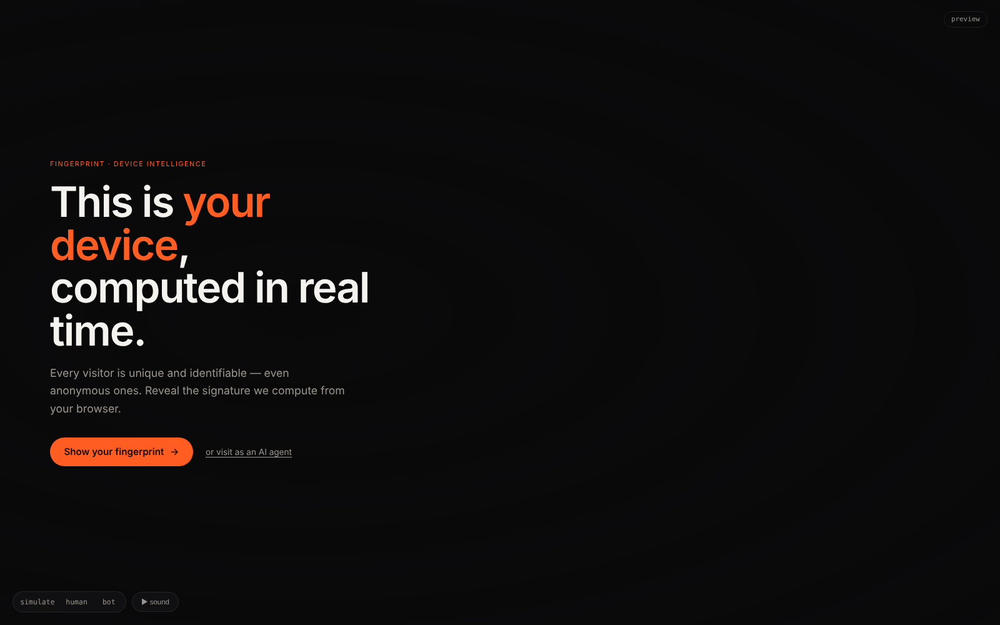
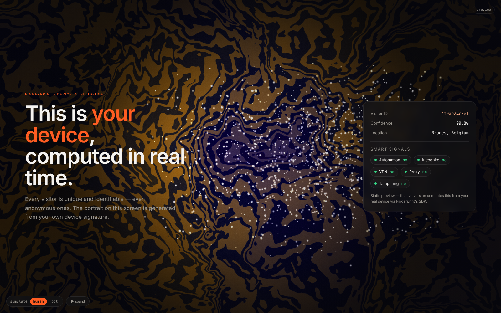

# Signal Portrait

An interactive demo of Fingerprint device intelligence: your visitor identity,
rendered live as a generative WebGL signal field. Built for Ward's application to
the **Design Engineer** role at Fingerprint.

> **The idea:** a fingerprint is a flow field. This renders *your* visitor ID as
> one — so the abstract identifier becomes something organic and singular, about
> the person looking at it. Humans get an elegant portrait; detected bots/AI
> agents get a **corrupted** one.





## Run it (≈2 minutes)

```bash
npm install
cp .env.local.example .env.local   # then paste your keys
npm run dev                         # http://localhost:3000
```

In `.env.local`:

| var | where | notes |
|---|---|---|
| `NEXT_PUBLIC_FINGERPRINT_PUBLIC_KEY` | Fingerprint dashboard → API keys (public) | safe in the browser |
| `NEXT_PUBLIC_FINGERPRINT_REGION` | `eu` for a Belgium workspace | `us` / `eu` / `ap` |
| `FINGERPRINT_SECRET_KEY` | dashboard → API keys (secret) | **server only**, gitignored |

It degrades gracefully: **no keys** → the visual runs in "demo mode"; **public
key only** → live visitor ID + portrait; **public + secret** → full Smart Signals.

Use the **simulate: human / bot** toggle (bottom-left) to trigger the bot state
yourself — you're (presumably) not a bot.

## How it works

```
Browser ──getData()──► Fingerprint agent ──► { event_id, visitor_id }
   │
   └── POST /api/identify { event_id }         (event_id only — never trust the client id)
          │
          └── server: @fingerprint/node-sdk .getEvent(event_id) with the SECRET key
                 └── trusted identification + Smart Signals (bot, incognito, vpn, …)
```

- The `visitor_id` is used only to **seed the shader** (deterministic: same
  device → same portrait). All trust-bearing data comes from the server call.
- `event.bot === "bad"` (automation / AI agent) flips the UI into the glitch
  state — Fingerprint's own AI Agent Detection, turned into a moment.

## Stack (maps to the job description)

| Requirement | Here |
|---|---|
| React + modern framework | Next.js 16 (App Router), TypeScript |
| Canvas animations + shaders *(required)* | three.js + hand-written GLSL (`SignalPortrait.tsx`) |
| Prototyping motion in the browser *(required)* | motion.dev (`motion/react`) |
| three.js / WebGL / motion.dev *(preferred)* | all three |
| Their SDKs | `@fingerprint/agent` (client, on reveal) + `@fingerprint/node-sdk` (server) |
| Perf / a11y | DPR cap, reduced-motion path, SSR-safe, lazy GL |

## The experience

1. **Gated entry** — land on the ambient fingerprint with a **"Show your
   fingerprint →"** CTA, plus a quieter **"or visit as an AI agent"** that
   emulates how an agent/bot sees the page.
2. **The particle bridge** *(the centrepiece)* — on click, the field crystallizes
   and ~1,800 three.js particles lift off nearly the whole fingerprint, then fade
   into the data panel as it appears. The data comes *from* your fingerprint.
   (See `SignalPortrait.tsx` — `PVERT`/`PFRAG`.)
3. **Magnetic cursor** — the field bends toward the pointer.
4. **Signal-reactive** — hovering a Smart Signal chip ripples the field; a bad-bot
   verdict corrupts it (RGB split, datamosh tears, red particles).

**Audio** is on when the page allows it. The button reads "stop sound" while the
pad is playing and "play sound" while it is quiet. Bot swaps that bed for a TV-test tone — a beating 1 kHz square, a slow
sweep, and a layer of noise — plus a short sting. Buttons get a dry tick.

A **simulate: human / bot** toggle (shown after reveal) lets a human reviewer
trigger the agent state.

## Project layout

```
app/
  layout.tsx              root shell (fonts). The agent starts on reveal, not here.
  page.tsx                renders <Experience/>
  api/identify/route.ts   server: secret-key Server-API call (official node-sdk)
  components/
    Experience.tsx        orchestration: identify → enrich → render
    SignalPortrait.tsx    three.js + GLSL shader (the showpiece)
    SignalsPanel.tsx      visitor id, confidence, Smart Signal chips (motion.dev)
lib/
  signals.ts              types, deterministic seed, server-event normalization
  audio.ts                minimal WebAudio (on by default, gesture if the browser blocks it)
preview/index.html        standalone static preview (no build, no keys)
docs/                     PRD.md, BRAND.md, screenshots
```

## Notes / next steps
- Deploy to Vercel for a shareable link (needs the three env vars).
- Confirm workspace region (default `eu`).
- The raw-event JSON is available in a collapsible panel for engineers.
