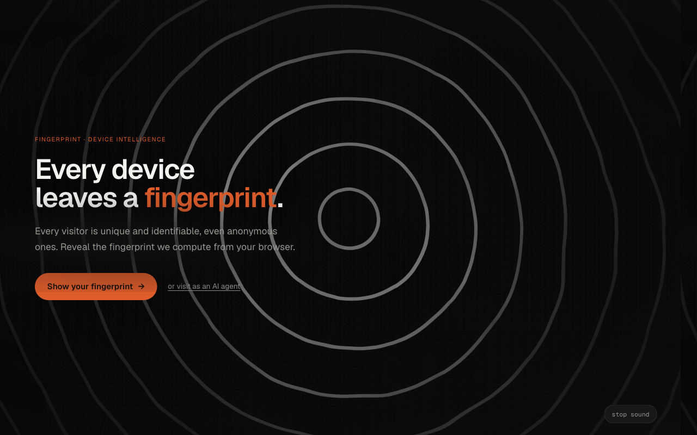
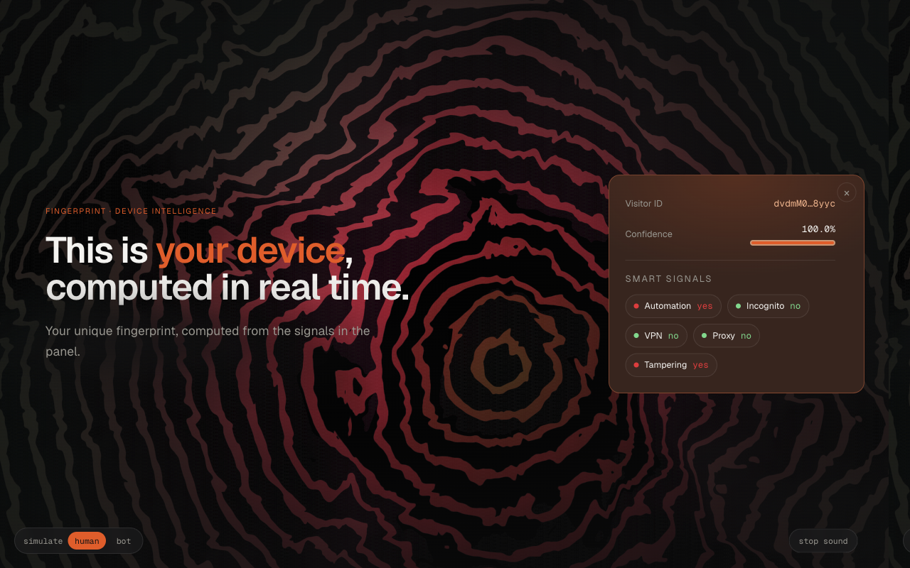
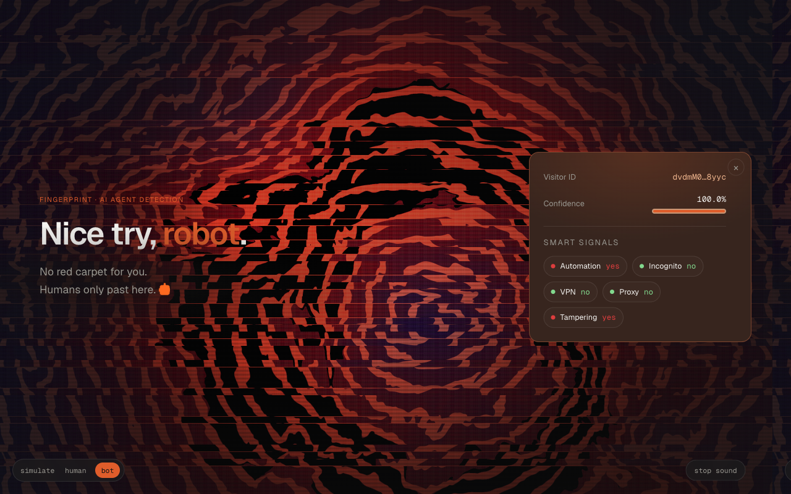

# Signal Portrait

An interactive demo of Fingerprint device intelligence. The page opens on a generic field. After you ask, it identifies the browser and draws that visitor as a generative WebGL portrait. Built for Ward's application to the **Design Engineer** role at Fingerprint.

Humans get a warm, colored whorl. A detected bot, or a visit chosen as an AI agent, gets a corrupted red one.



*Homepage. Thin gray rings, not yet a fingerprint.*



*After the click. The rings have tightened into this device's portrait, and the panel shows the signals it was computed from.*



*A bot visit. The same field, glitched.*

## Run it

```bash
npm install
npm run dev    # http://localhost:3000
```

Create `.env.local` (it is gitignored) with:

| var | where | notes |
|---|---|---|
| `NEXT_PUBLIC_FINGERPRINT_PUBLIC_KEY` | Fingerprint dashboard → API keys (public) | safe in the browser |
| `NEXT_PUBLIC_FINGERPRINT_REGION` | `eu` for this workspace | `us` / `eu` / `ap` |
| `FINGERPRINT_SECRET_KEY` | dashboard → API keys (secret) | **server only** |

**No keys** → the visual runs in demo mode. **Public key only** → a live visitor ID and portrait. **Public + secret** → confidence, location, and Smart Signals.

The source is at [github.com/flybylow/fingerprint](https://github.com/flybylow/fingerprint). To deploy, import that repo in Vercel and set the three variables above.

## The experience

1. **Homepage.** The eyebrow is "Fingerprint · device intelligence". The title is **Every device leaves a fingerprint.** Under it: "Every visitor is unique and identifiable, even anonymous ones. Reveal the fingerprint we compute from your browser." The field is many thin gray lines on a fixed center, bent slightly so they are not perfect circles, darker toward the middle so the type stays readable. They drift outward with the homepage pad, and the pointer dents them. Two actions: **Show your fingerprint →** and **or visit as an AI agent**.

2. **A person.** The title becomes **This is your device, computed in real time.** The line under it is "Your unique fingerprint, computed from the signals in the panel." Color arrives with the warp: the rings tighten, shift off center, and bend into a whorl seeded by the visitor ID. About 1,800 particles lift off the field and fade into the card. Closing the card does not send them back. The card shows the visitor ID, a confidence bar, location when the server has it, and Smart Signals. A collapsed raw event sits under the chips for engineers.

3. **A bot.** Choosing "visit as an AI agent", or a detection of automation, lands on **Nice try, robot.** with "No red carpet for you. Humans only past here." The portrait glitches and shifts red.

4. **The switch.** After the card opens, the bottom-left control is already on **human** or **bot**, matching what was chosen or what identification found. Either side can still be overridden.

5. **Sound.** On when the browser allows it. The button reads **stop sound** while the pad is playing and **play sound** while it is quiet. The homepage is a low beating pad. A human identification crossfades into a warmer A-major chord. A bot swaps the bed for a TV-test tone. Buttons get a dry tick.

How a visitor ID becomes the whorl is written up in [docs/portrait.md](docs/portrait.md).

## How identification works

```
Browser ──getData()──► Fingerprint agent ──► { event_id, visitor_id }
   │
   └── POST /api/identify { event_id }         (event_id only — never trust the client id)
          │
          └── server: @fingerprint/node-sdk .getEvent(event_id) with the SECRET key
                 └── trusted identification + Smart Signals (bot, incognito, vpn, …)
```

The agent starts on the reveal click, not on page load. The `visitor_id` only seeds the shader, so the same device always draws the same portrait. Trust-bearing data comes from the server call. `event.bot === "bad"` (automation / AI agent) is what flips the portrait into the glitch state.

## Stack

| Requirement | Here |
|---|---|
| React + modern framework | Next.js 16 (App Router), TypeScript |
| Canvas animations + shaders | three.js + hand-written GLSL (`SignalPortrait.tsx`) |
| Motion in the browser | motion.dev (`motion/react`) |
| Their SDKs | `@fingerprint/agent` (client, on reveal) + `@fingerprint/node-sdk` (server) |
| Perf / a11y | DPR cap, reduced-motion path, SSR-safe, lazy GL |

## Project layout

```
app/
  layout.tsx              root shell (fonts). The agent does not start here.
  page.tsx                renders <Experience/>
  api/identify/route.ts   server: secret-key Server API call
  components/
    Experience.tsx        identify → enrich → render
    SignalPortrait.tsx    three.js + GLSL field and particle flight
    SignalsPanel.tsx      visitor id, confidence, Smart Signals
lib/
  signals.ts              types, deterministic seed, server-event normalization
  audio.ts                WebAudio beds (home, welcome, bot)
docs/                     portrait, PRD, brand, screenshots
```
